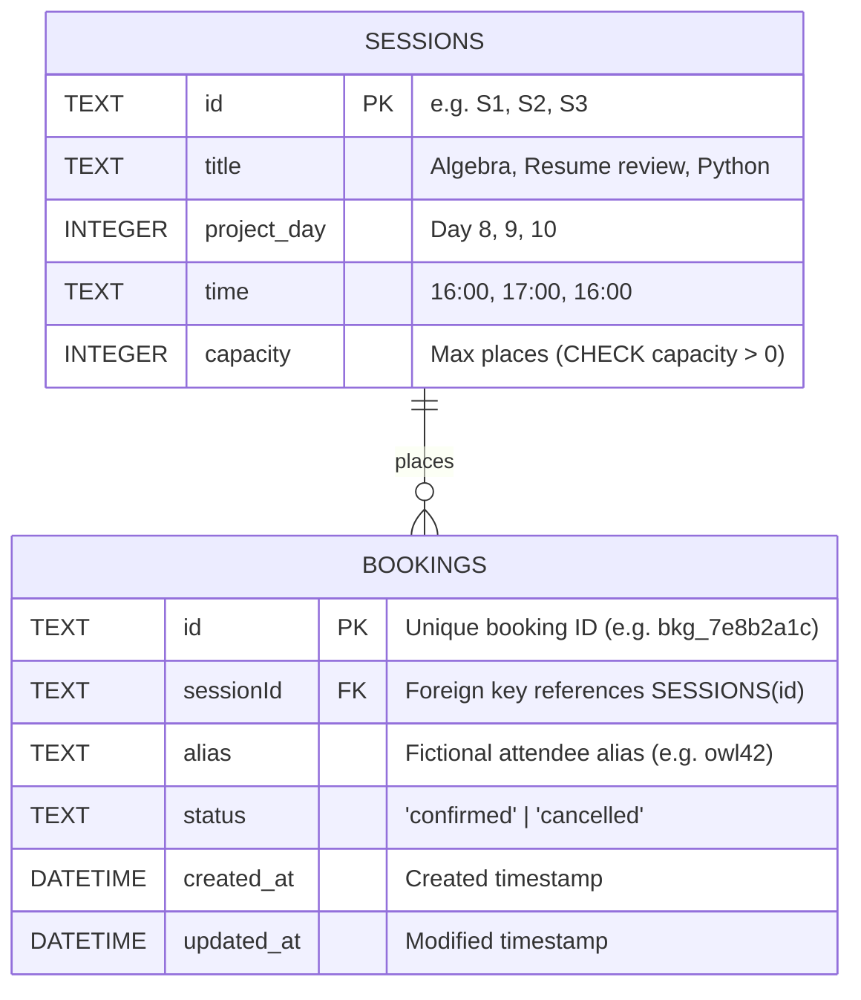

# StudySwap — Peer Study Session Booking System

> **CareerSwami Full-Stack Web Development — Project 1 Submission**  
> **Core Constraint**: A session cannot be overbooked. The fourth person must never get into a session with three places.

---

## 1. Quick Start (Under 2 Minutes)

This project has **zero external package dependencies**. It runs natively using Node's built-in HTTP server (`node:http`) and built-in SQLite engine (`node:sqlite`). Anyone with Node.js installed can clone and run it immediately without running complex build chains.

### Prerequisites & Versions
- **Node.js**: `v22.5.0` or higher (Tested and developed on `v24.18.0`)
- **NPM**: `v10.x` or `v12.x` (Tested on `12.2.3`)
- **Database**: SQLite (built directly into the Node.js runtime, no external server required)

### Setup & Run Commands

```bash
# 1. Clone repository and enter project directory
cd internship

# 2. Initialize database and seed initial sessions from data/sessions.csv
npm run seed

# 3. Start the application
npm start
```

The server will be available at:
- **Web UI**: `http://localhost:3000/` (Features interactive session details, visual seat allocations, real-time concurrency proofs, dark mode, and live traffic terminal)
- **Health Endpoint**: `http://localhost:3000/health`
- **API Base**: `http://localhost:3000/sessions`

To run the automated validation test suite:
```bash
npm test
```

To run the concurrency race-condition stress test:
```bash
npm run test:concurrency
```

To reset the database to clean seed state at any time:
```bash
npm run reset
```

---

## 2. Architecture & Data Model

### Entity-Relationship Diagram



### Where Capacity Is Enforced and How

A naive implementation counts existing bookings in application code and executes an `INSERT` if `count < capacity`. Under concurrent traffic, multiple requests simultaneously pass the check and insert rows, leading to overbooking.

StudySwap enforces capacity **directly at the database layer** using two complementary mechanisms:

1. **SQLite `BEFORE INSERT` Trigger (`check_session_capacity_before_insert`)**:
   ```sql
   CREATE TRIGGER IF NOT EXISTS check_session_capacity_before_insert
   BEFORE INSERT ON bookings
   FOR EACH ROW
   WHEN NEW.status = 'confirmed' AND (
     SELECT COUNT(*) FROM bookings 
     WHERE sessionId = NEW.sessionId AND status = 'confirmed'
   ) >= (
     SELECT capacity FROM sessions WHERE id = NEW.sessionId
   )
   BEGIN
     SELECT RAISE(ABORT, 'CAPACITY_EXCEEDED');
   END;
   ```
2. **Atomic Serialization with `BEGIN IMMEDIATE`**:
   The booking handler executes within an immediate transaction:
   ```sql
   BEGIN IMMEDIATE;
   INSERT INTO bookings (...) VALUES (...);
   COMMIT;
   ```
   If 10 concurrent requests arrive for the last remaining seat, the database engine executes the inserts sequentially. The moment capacity is reached, the database trigger aborts subsequent insertions with `ABORT: CAPACITY_EXCEEDED`, and the application maps this directly to HTTP `409 Conflict`.

---

## 3. The Four Core Project Cases

### Case 1: The 4th booking on a 3-place session
- **Behavior**: Rejected with HTTP `409 Conflict`.
- **Response**:
  ```json
  {
    "error": "session_full",
    "message": "This session has no places left."
  }
  ```
- **Proof**: `SELECT count(*) FROM bookings WHERE sessionId = 'S1' AND status = 'confirmed'` strictly remains `3`.

### Case 2: Booking for a session that does not exist
- **Behavior**: Rejected with HTTP `404 Not Found`.
- **Enforcement**: Foreign Key constraint (`FOREIGN KEY (sessionId) REFERENCES sessions(id)`) and route pre-validation.
- **Response**:
  ```json
  {
    "error": "session_not_found",
    "message": "Session with id 'S999' was not found."
  }
  ```

### Case 3: The same person booking twice (Policy Decision)
- **Chosen Rule**: An alias cannot hold more than one active (`confirmed`) booking for the same session.
- **Enforcement**: Partial unique index:
  ```sql
  CREATE UNIQUE INDEX idx_unique_active_booking 
  ON bookings(sessionId, alias) 
  WHERE status = 'confirmed';
  ```
- **Behavior**: Duplicate active booking attempts are rejected with HTTP `409 Conflict`:
  ```json
  {
    "error": "duplicate_booking",
    "message": "Alias 'owl42' already has an active booking for this session."
  }
  ```

### Case 4: The server restarts
- **Behavior**: All sessions and bookings persist on disk across process crashes and server restarts.
- **Enforcement**: Stored in `data/studyswap.db` using WAL mode. Verified via automated test opening a fresh SQLite connection after server shutdown.

### Full Cancellation Lifecycle
- Cancelling via `POST /bookings/:id/cancel` sets `status = 'cancelled'`.
- Since capacity calculation only counts `status = 'confirmed'`, cancelling frees the place immediately.
- The full cycle (`book -> cancel -> book again`) is verified: the previously rejected 4th person can immediately take the freed place.

---

## 4. Worked Example (Grade-Deciding Test)

Below is the verbatim terminal evidence captured from `npm test`:

```
===============================================================
 StudySwap Automated Test Suite (Validation & Evidence)
===============================================================

[Test Server] Listening on http://localhost:3333

  PASS: Reset database to clean seed state
  PASS: Health endpoint returns 200 OK with status "ok"
  PASS: GET /sessions returns 3 initial seeded sessions with correct capacities
  PASS: GET /sessions/S1 returns session details with empty bookings
  PASS: Book seat 1 on S1 (owl1) -> 201 Created
  PASS: Book seat 2 on S1 (owl2) -> 201 Created
  PASS: Book seat 3 on S1 (owl3) -> 201 Created (S1 is now full)
  PASS: CASE 1: The 4th booking on a 3-place session MUST be rejected with 409 Conflict
  PASS: CASE 2: Booking for non-existent session MUST be rejected with 404 Not Found
  PASS: CASE 3: Same alias booking twice on the same session MUST be rejected with 409 Conflict
  PASS: Cancel booking 1 on S1 releases seat back to the pool
  PASS: The previously rejected 4th person ("owl42") now succeeds after cancellation
  PASS: Validation: Reject missing or blank fields with 400 Bad Request
  PASS: CASE 4: Data persists across server restarts (SQLite file backing)

===============================================================
 Test Summary: 14 Passed, 0 Failed
===============================================================
```

### Concurrency Stress Test Evidence
```
===================================================================
 StudySwap Concurrency Stress Test
 Testing simultaneous race conditions on S2 (Capacity: 2)
===================================================================

Sending 10 simultaneous POST /bookings requests for S2...

Results Breakdown:
  [201 CREATED]  Seat booked for alias "racer_1" -> id: bkg_4364308e
  [201 CREATED]  Seat booked for alias "racer_2" -> id: bkg_c3c0e9ad
  [409 CONFLICT] Rejected overbooking for alias "racer_3" -> error: session_full
  [409 CONFLICT] Rejected overbooking for alias "racer_4" -> error: session_full
  [409 CONFLICT] Rejected overbooking for alias "racer_5" -> error: session_full
  [409 CONFLICT] Rejected overbooking for alias "racer_6" -> error: session_full
  [409 CONFLICT] Rejected overbooking for alias "racer_7" -> error: session_full
  [409 CONFLICT] Rejected overbooking for alias "racer_8" -> error: session_full
  [409 CONFLICT] Rejected overbooking for alias "racer_9" -> error: session_full
  [409 CONFLICT] Rejected overbooking for alias "racer_10" -> error: session_full

-------------------------------------------------------------------
Total Requests:    10
Successful (201):  2 (Expected: exactly 2)
Rejected (409):    8 (Expected: exactly 8)
Database count:    2 (Must be strictly <= 2)
-------------------------------------------------------------------

✅ CONCURRENCY TEST PASSED: Zero overbooking verified under heavy race condition!
```

---

## 5. API Reference

Full specification available in [`docs/API_CONTRACT.md`](docs/API_CONTRACT.md).

| Method | Route | Description | Success Code |
| :--- | :--- | :--- | :--- |
| `GET` | `/health` | Service health and database check | `200 OK` |
| `GET` | `/sessions` | List all sessions with availability | `200 OK` |
| `GET` | `/sessions/:id` | Get session details and active attendees | `200 OK` |
| `POST` | `/bookings` | Book a seat (`{ sessionId, alias }`) | `201 Created` |
| `POST` | `/bookings/:id/cancel` | Cancel booking and release seat | `200 OK` |
| `GET` | `/bookings/:id` | Get single booking record | `200 OK` |
| `POST` | `/reset` | Restore clean database from `sessions.csv` | `200 OK` |

---

## 6. Starter Kit Deliverables Checklist

- [x] `README.md`: Setup commands, ER diagram, concurrency explanation, worked examples
- [x] `docs/API_CONTRACT.md`: Full endpoint definitions, success payloads, and error codes
- [x] `docs/ARCHITECTURE.md`: Database triggers, transaction boundaries, and concurrency model
- [x] `data/sessions.csv`: Seed dataset (S1 Algebra, S2 Resume review, S3 Python)
- [x] `src/db.js`: SQLite schema, triggers, and atomic functions
- [x] `src/server.js`: Native HTTP REST server and static file server
- [x] `public/`: Interactive web UI with live concurrency testing and response inspector
- [x] `test/test-suite.js`: 14 automated validation tests
- [x] `test/test-concurrency.js`: 10-worker race condition stress test
- [x] `evidence-log.csv`: Completed evidence log
- [x] `file-index.csv`: Submission file inventory
- [x] `worksheet-01.csv` to `worksheet-06.csv`: Completed checkpoint worksheets

