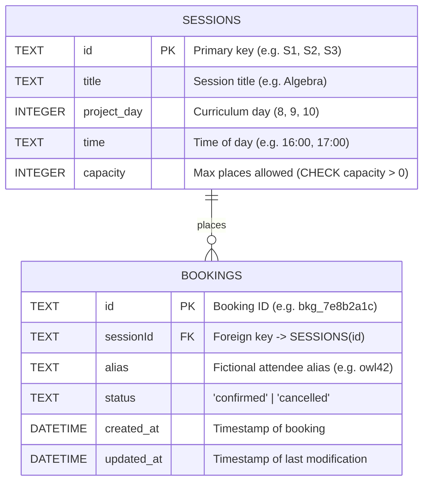

# StudySwap Architecture & Concurrency Model

## 1. System Overview
StudySwap solves the fundamental concurrency problem in web applications: **ensuring that two or more simultaneous booking requests can never consume the last available seat**.

The architecture enforces capacity **directly at the data layer** using SQLite engine constraints and triggers, backed by atomic transaction serialization.

---

## 2. Entity-Relationship Diagram



---

## 3. Data-Layer Capacity Enforcement

### The Flaw of Naive Code
In naive implementations:
```
Request 1: Reads COUNT(*) -> finds 2 (capacity is 3) -> valid!
Request 2: Reads COUNT(*) -> finds 2 (capacity is 3) -> valid!
Request 1: INSERT into bookings (total becomes 3)
Request 2: INSERT into bookings (total becomes 4 -- OVERBOOKED!)
```
An application-level `if (count >= capacity)` fails because the check and insert are decoupled operations.

### The StudySwap Solution
StudySwap enforces capacity **where the data lives**:

1. **SQLite Database Trigger (`BEFORE INSERT`)**:
   ```sql
   CREATE TRIGGER check_session_capacity_before_insert
   BEFORE INSERT ON bookings
   FOR EACH ROW
   WHEN NEW.status = 'confirmed' AND (
     SELECT COUNT(*) FROM bookings 
     WHERE sessionId = NEW.sessionId AND status = 'confirmed'
   ) >= (
     SELECT capacity FROM sessions WHERE id = NEW.sessionId
   )
   BEGIN
     SELECT RAISE(ABORT, 'CAPACITY_EXCEEDED');
   END;
   ```

2. **Atomic Write Serialization (`BEGIN IMMEDIATE`)**:
   SQLite is operated in `WAL` mode (`PRAGMA journal_mode = WAL;`) with `PRAGMA foreign_keys = ON;`.
   When `POST /bookings` is called, it initiates an immediate write lock:
   ```sql
   BEGIN IMMEDIATE;
   INSERT INTO bookings (...) VALUES (...);
   COMMIT;
   ```
   Even when multiple concurrent requests hit the server at the exact same millisecond:
   - Requests are queued sequentially by the database engine.
   - The trigger evaluates the count atomically during each insert.
   - Any insertion attempting to exceed session capacity is immediately aborted with `ABORT: CAPACITY_EXCEEDED`.
   - The application catches this error and maps it to HTTP `409 Conflict`.

3. **Active Booking Uniqueness (`UNIQUE INDEX`)**:
   ```sql
   CREATE UNIQUE INDEX idx_unique_active_booking 
   ON bookings(sessionId, alias) 
   WHERE status = 'confirmed';
   ```
   This prevents the same fictional alias from double-booking the same session while their booking remains active.

---

## 4. The 4 Cases Handled

| Case | Mechanism | HTTP Status | Response |
| :--- | :--- | :--- | :--- |
| **1. 4th booking on 3-place session** | SQLite `BEFORE INSERT` Trigger | `409 Conflict` | `{"error": "session_full", "message": "This session has no places left."}` |
| **2. Booking for non-existent session** | Foreign Key + Server Validation | `404 Not Found` | `{"error": "session_not_found", "message": "Session with id '...' was not found."}` |
| **3. Same alias booking twice** | Partial Unique Index on `(sessionId, alias)` | `409 Conflict` | `{"error": "duplicate_booking", "message": "Alias '...' already has an active booking..."}` |
| **4. Server restarts** | Persistent file `data/studyswap.db` | Data preserved | Zero data loss across server lifecycles |
| **5. Full Cancellation Cycle** | Sets status to `'cancelled'`, releases seat | `200 OK` | Frees seat immediately (`book -> cancel -> book again`) |

